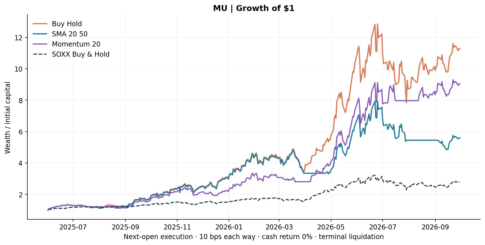
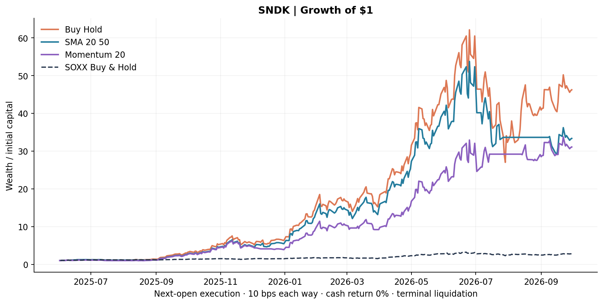
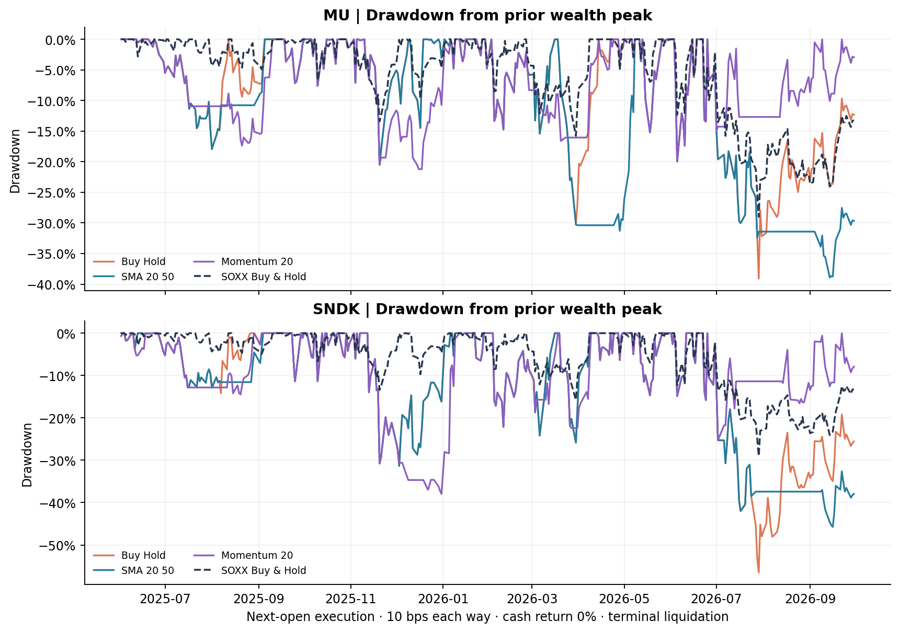
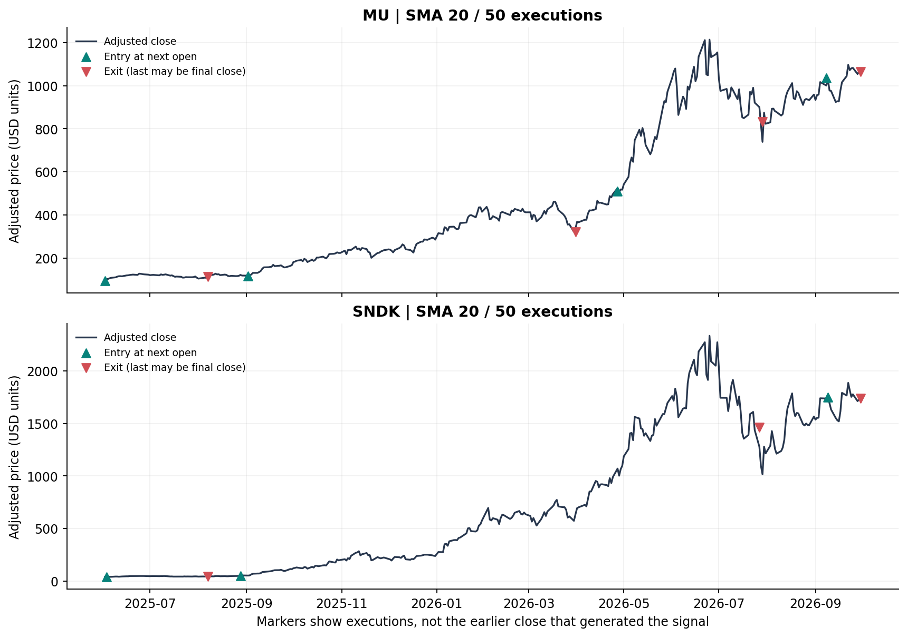
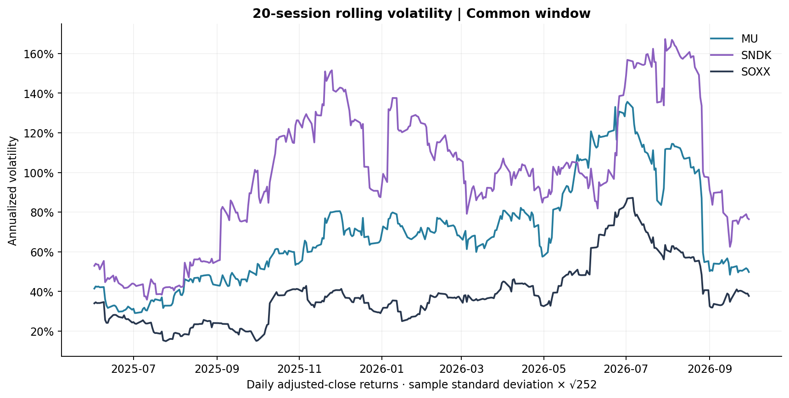
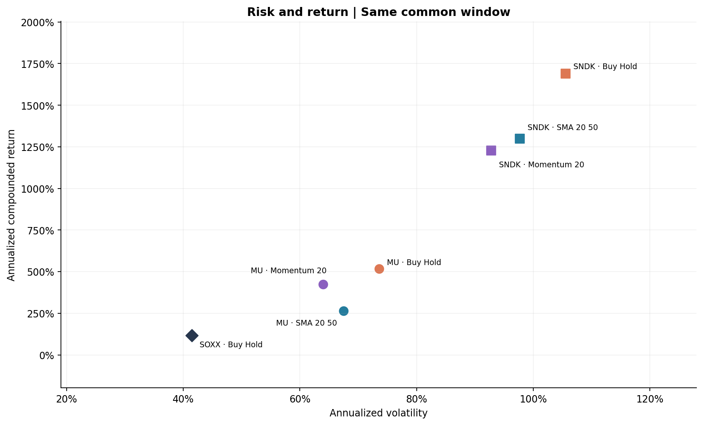
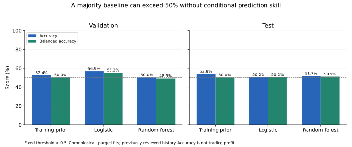
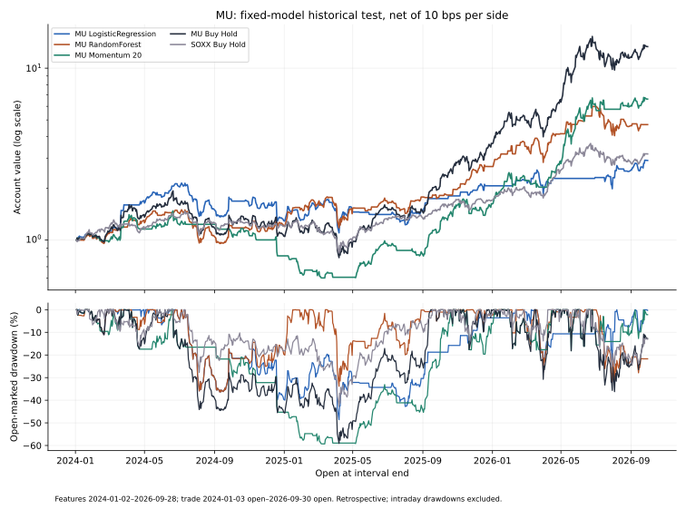

# Quantitative Trading Signals and Risk Backtesting in Semiconductor Equities

How much return does a long-or-cash rule give up to reduce drawdown in semiconductor stocks? This independent, AI-assisted Python and SQLite study compares two fixed trading rules with holding MU or SNDK, using SOXX as the sector benchmark.

**Finding:** From June 2, 2025 through September 30, 2026, MU’s 20-session momentum strategy returned 803.0% after costs versus 1,026.8% for holding MU. Its maximum drawdown was 21.2% versus 39.1%. Momentum also reduced drawdown on SNDK in this window, but the risk advantage did not hold across all MU windows. In a separate 687-session MU classification test, neither logistic regression nor random forest beat the training-majority baseline on accuracy.

[Core findings](reports/findings.md) · [Research design](docs/research_design.md) · [Metric definitions](docs/data_and_metrics.md) · [ML results](reports/ml/findings.md) · [Inverse ETF appendix](reports/sndk_inverse/findings.md)

## Core study design

| Item | V1 decision |
|---|---|
| Core assets | Micron (MU), Sandisk (SNDK) |
| Sector reference | iShares Semiconductor ETF (SOXX), buy-and-hold |
| Long-history evaluation | MU / SOXX, 2020-01-02 through 2026-09-30 |
| Common-period evaluation | MU / SNDK / SOXX, 2025-06-02 through 2026-09-30 |
| Warmup data | MU / SOXX from 2019; SNDK from 2025-02-24 |
| Strategies | SMA 20/50; positive 20-session momentum |
| Exposure | Long or cash; no leverage or short selling |
| Timing | Close-day signal → following session's open |
| Trading cost | 10 bps per side; sensitivity at 0 / 10 / 25 bps |
| Baselines | Same-stock buy-and-hold and SOXX buy-and-hold, identical evaluation dates and cost convention |
| Cash / Sharpe reference | 0% annual rate, explicitly labeled |

SNDK began trading as the current independent company on **2025-02-24**. V1 excludes older SNDK history and does not splice in Western Digital. The June common start leaves room for a full 50-session moving-average warmup. NVDA and AMD are possible later comparisons, not part of the V1 universe.

V1 rules and dates are recorded in `config.json`. They were chosen on 2026-10-01, **after** the historical period. The 2024 onward chronological test is therefore retrospective, not evidence of an untouched or prospective out-of-sample result. No parameter search is performed in V1; the separately labeled V1.1 extension uses a fixed 36-candidate grid.

## Reproduce

Use Python 3.12 to reproduce the study. Tested environments are recorded in `reports/environment.json` (V1) and `reports/ml/provenance.json` (ML001).

```bash
python -m venv .venv
# Windows PowerShell:
.venv\Scripts\Activate.ps1
# macOS / Linux alternative:
# source .venv/bin/activate
python -m pip install -r requirements.txt
python -m pytest -q
python -m src.pipeline
python -m jupyterlab
```

Open `notebooks/01_data_collection.ipynb`, then work through 02–04. Notebooks find the repository root automatically. The pipeline downloads data when no snapshot exists and otherwise verifies and reuses the saved snapshot. A deliberate new download uses `python -m src.pipeline --refresh` and may reflect vendor revisions. A provider failure stops the run; there is no simulated-price fallback.

Raw market prices, the SQLite database and the snapshot manifest are excluded. A fresh download may differ from the reported snapshot after vendor revisions.

## Core results and figures

See [findings](reports/findings.md) for measured returns, drawdowns, exposure, Sharpe ratios and trade counts. Full tables and the trade ledger are in `reports/`. These results are exploratory and do not establish future profitability.








## Files

```text
semiconductor-quant-backtesting/
├── README.md
├── config.json
├── config_sndk_inverse.json  # V1.1 grid, split and cost assumptions
├── config_ml.json            # ML001 fixed features, models, splits and costs
├── data/                    # Private snapshots; not committed
├── notebooks/               # 01–04 core; 05 optional ETF appendix; 06 ML001
├── src/                     # Data, indicators, backtest, metrics, plots, pipeline
├── sql/market_analysis.sql  # Coverage, LAG returns, rolling means, joins
├── tests/                   # Timing, costs, missing data, indicator causality
├── docs/                    # Design, metric definitions, frozen ML protocol
├── reports/                 # V1 results; sndk_inverse/ and ml/ are separate
├── figures/
└── requirements.txt
```

## Main limitations

- A small, deliberately selected current universe creates selection/survivorship bias; it is not representative of all semiconductor stocks.
- SNDK supplies a short post-separation sample. Annualized numbers can be unstable and trade win rates may rest on very few observations.
- Adjusted open prices are derived from the vendor's adjusted-close factor. This is a total-return approximation, not a cash-dividend/share-count ledger or a point-in-time corporate-action database.
- Fixed proportional costs simplify spreads, slippage and liquidity. No taxes, financing constraints or execution capacity are modeled.
- Lower drawdown can come from spending more time in cash. Exposure is reported to make that trade-off visible.
- A Sharpe ratio with a zero reference rate is not a Sharpe ratio using historical Treasury yields. No significance or predictive-skill claim is made.

## Optional appendix: SNDK inverse-ETF research (V1.1)

Read this after notebooks 01–04. It is independent of the core V1 workflow.
See the [protocol](docs/sndk_inverse_protocol.md) and [results](reports/sndk_inverse/findings.md).

```bash
python -m src.sndk_inverse_pipeline
```

This optional extension tests four SNDK features (5-session momentum, SMA20 distance,
RSI14 and price Z-score20) at three fixed thresholds and 1/3/5-session holding periods.
It uses **actual** SNDQ and SNXX daily prices, next-open entries, non-overlapping trades,
cost sensitivity and training-only selection followed by chronological validation.
The ETF comparison begins on 2026-04-23; validation begins on 2026-08-03.
Unlike the V1 stock accounts, these ETFs embed daily-reset leverage of −2× and +2×.

The initial snapshot does **not** show greater mean SNDK high–low range on down days.
The training-selected SNDQ rule has 17 validation trades, with a 64.7% win rate but
a payoff ratio below 1; training maximum drawdown is 59.5%. At 50 bps cost per side,
its validation account return turns negative. These are short-sample exploratory
findings, not a stable optimal entry threshold or an explanation of personal P&L.
See the [full report](reports/sndk_inverse/findings.md) for all definitions, periods,
benchmarks, costs and limitations, and [Notebook 05](notebooks/05_sndk_inverse_research.ipynb)
for the walkthrough. This is a rule-based extension, separate from ML001 below.

ETF snapshots have separate immutable version folders under ignored `data/raw/`.
`--refresh` creates a new ETF version; it does not refresh the V1 underlying data.
Hashes identify the exact input files but cannot guarantee vendor accuracy or that
redownloading later will reproduce the same bytes.

## Machine-learning experiment: ML001

[Notebook 06](notebooks/06_machine_learning.ipynb) · [Protocol](docs/ml_protocol.md) ·
[Full results](reports/ml/findings.md) · [Verification](reports/ml/validation.md)

```bash
# Requires the verified V1 snapshot; never silently refreshes prices.
python -m src.ml_pipeline
```

MU is used first because its longer history supports chronological splits. Nine
past/present price-volume features predict whether adjusted open t+2 exceeds open
t+1, using information at close t. Initial training is 2020–2022, validation is
2023, and the final unchanged models are refitted on eligible 2020–2023 labels
before a fixed 2024–2026 historical test. Labels reaching the next block are purged;
scaling fits training only. There is no model/threshold search or test-period refit.

| Test classifier | Accuracy | Balanced accuracy | ROC-AUC |
|---|---:|---:|---:|
| Training-majority baseline | 53.86% | 50.00% | 0.500 |
| Logistic regression | 50.22% | 50.21% | 0.520 |
| Random forest | 51.67% | 50.93% | 0.513 |

The test has **687** one-session intervals, from 2024-01-03 open to 2026-09-30 open.
At 10 bps per side, logistic/random-forest account returns are **190.6% / 369.4%**,
versus **1234.2%** for MU buy-and-hold over the identical execution window. Their
open-sampled drawdowns are smaller, with only **50.1% / 59.7%** exposure. Both
classifiers trail the majority baseline in accuracy and probability loss; this
experiment does not establish stable incremental predictive or economic value.
All model, simple-rule and benchmark results, cost variants and trade records are
retained. The large historical returns are snapshot observations, not forecasts.




ML accounts are marked and finally liquidated at opens to match the target.
V1 is close-marked, so its existing metrics are not copied into this comparison.
The historical market data were already reviewed in V1; chronological fit isolation
does not turn them into a pristine future holdout. SNDK training, additional
horizons and retraining searches are deferred. Negative results are part of the study.

## Sources

- [Sandisk: separation and Nasdaq listing, 2025-02-24](https://www.sandisk.com/en-ca/company/newsroom/press-releases/2025/sandisk-celebrates-nasdaq-listing-after-completing-separation)
- [iShares: SOXX fund information](https://www.ishares.com/us/products/239705/ishares-phlx-semiconductor-etf)
- [Yahoo Finance: MU historical data](https://finance.yahoo.com/quote/MU/history/) — the downloader uses Yahoo's public chart response; this is an unofficial interface without an availability guarantee.

This is a retrospective research study. It does not connect to a brokerage or place orders.
