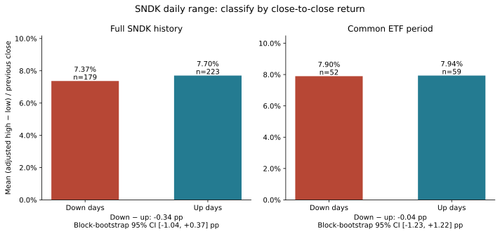
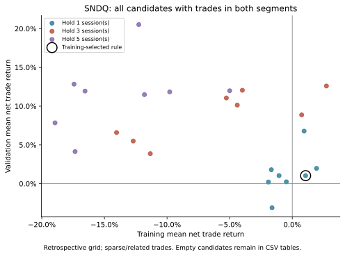
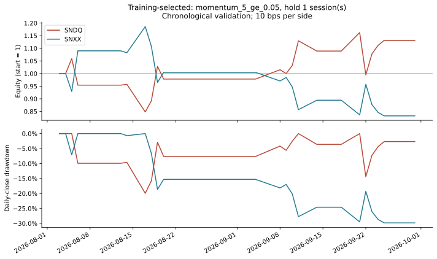

# SNDK range and inverse-ETF research

Retrospective exploratory extension; rules and split fixed on 2026-10-02. Not an untouched out-of-sample or personal-P&L attribution result.

SNDK: 403 bars; SNDQ: 111; SNXX: 171. ETF comparison: 2026-04-23 through 2026-09-30. Validation starts 2026-08-03. Base cost: 10 bps per side.

## Daily range

Up/down uses adjusted close-to-close returns. Range is (adjusted high − low) / previous adjusted close.

| Window | Down days | Up days | Down mean range | Up mean range | Difference (pp) | 95% block interval (pp) |
|---|---:|---:|---:|---:|---:|---:|
| full_sndk | 179 | 223 | 7.37% | 7.70% | -0.34 | [-1.04, +0.37] |
| etf_common | 52 | 59 | 7.90% | 7.94% | -0.04 | [-1.23, +1.22] |

A negative difference means down days have a smaller mean range. Intervals are descriptive and depend on the 5-session block assumption. Median range, intraday body, gap and open-to-close classification are in range_summary.csv.

## Training selection

5 of 36 candidates meet the training eligibility rule (at least 20 trades and both wins and losses). Selection maximizes training mean net trade return; a non-positive maximum selects nothing.

| Training criterion | Rule | Hold sessions | Trades | Training value |
|---|---|---:|---:|---:|
| mean_net_return | momentum_5_ge_0.05 | 1 | 37 | 1.06% |
| win_rate | momentum_5_ge_0.1 | 1 | 25 | 64.00% |
| payoff_ratio | momentum_5_ge_0.05 | 1 | 37 | 0.77 |

Frozen candidate: **momentum_5_ge_0.05, hold 1 session(s)**.

| Segment | ETF | Trades | Win rate | Payoff | Mean net/trade | Account return | Max drawdown |
|---|---|---:|---:|---:|---:|---:|---:|
| train | SNDQ | 37 | 62.16% | 0.77 | 1.06% | 14.37% | -59.53% |
| train | SNXX | 37 | 37.84% | 1.01 | -2.13% | -64.84% | -78.46% |
| validation | SNDQ | 17 | 64.71% | 0.75 | 1.03% | 13.16% | -19.95% |
| validation | SNXX | 17 | 35.29% | 1.47 | -0.75% | -16.77% | -29.83% |

SNDQ validation win-rate Wilson interval: [41.30%, 82.69%]. Validation sample flag: **count_threshold_met**. Even a sufficient-count flag does not establish statistical significance or future edge.

A payoff below 1 means the average winning trade is smaller than the average losing trade. A higher win rate alone is not enough. The account reinvests capital, so arithmetic mean trade return is not compounded account return.

### Unconditional SNDQ comparison at the same holding horizon

This baseline enters whenever flat without a SNDK feature threshold. Its exposure and trading costs can differ from the conditional account.

| Segment | Trades | Win rate | Mean net/trade | Account return | Max drawdown | Exposure |
|---|---:|---:|---:|---:|---:|---:|
| train | 69 | 55.07% | -0.51% | -62.38% | -79.03% | 100.00% |
| validation | 42 | 47.62% | -1.84% | -62.75% | -68.21% | 100.00% |

### Frozen SNDQ candidate: cost sensitivity

10 bps = 0.10% per side; 50 bps = 0.50% per side. No rule is reselected at other costs.

| Segment | Cost/side (bps) | Win rate | Mean net/trade | Account return | Max drawdown |
|---|---:|---:|---:|---:|---:|
| train | 0 | 62.16% | 1.27% | 23.15% | -57.71% |
| train | 10 | 62.16% | 1.06% | 14.37% | -59.53% |
| train | 25 | 62.16% | 0.76% | 2.35% | -62.34% |
| train | 50 | 62.16% | 0.26% | -14.93% | -66.60% |
| validation | 0 | 64.71% | 1.23% | 17.07% | -19.47% |
| validation | 10 | 64.71% | 1.03% | 13.16% | -19.95% |
| validation | 25 | 64.71% | 0.72% | 7.53% | -20.67% |
| validation | 50 | 58.82% | 0.22% | -1.23% | -21.85% |

## What this can and cannot explain

- These are identical-rule hypothetical accounts, not the researcher's real trades. Personal P&L needs execution timestamps, position sizes, costs and FX records.
- An up/down-day label is only known after the day ends. A large range is neither a known-at-open signal nor a return that could all be captured.
- SNDQ and SNXX reset leverage daily. Observed ETF prices include path dependence and fund expenses; no pre-inception synthetic history or double expense charge is used.
- Training maxima are vulnerable to multiple testing. All candidates, including empty or losing ones, are retained. Validation is not used to reselect a rule.
- A few months of ETF data cannot establish a stable threshold across market regimes. No stop/target fill claims can be made from daily bars.

## Outputs and reproduction

Run `python -m src.sndk_inverse_pipeline` from the repository root. Use `--refresh` only for a deliberate new ETF snapshot; it preserves older ETF versions. The V1 underlying snapshot is reused and verified.

- `candidate_metrics.csv`: every declared candidate and unconditional baseline, both ETFs and both chronological segments, at base cost.
- `cost_sensitivity.csv`: the same frozen grid at 0/10/25/50 bps per side; no reselection.
- `trades.csv`: base-cost trade ledger, including signal/entry/exit dates.
- `range_summary.csv`, `range_intervals.csv`: both windows and day classifications.
- `data_audit.csv`: date coverage, observed split events and large-return checks.
- `selection.json`, `run_config.json`, `provenance.json`: rule choice, protocol and input hashes.

See [protocol and primary product sources](../../docs/sndk_inverse_protocol.md) for exact definitions.
